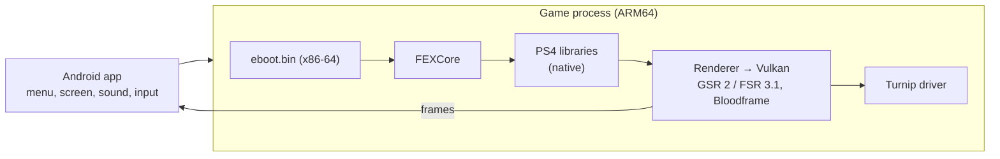

<p align="center"><a href="https://paypal.me/Ducvd89"></a></p>

<h1 align="center">Bloodborne-Android</h1>

<p align="center">
  <b>Bloodborne on Android</b>, for Snapdragon (Adreno) phones and handhelds.<br><b>Mali GPUs are not supported:</b> the Mali driver is in the app for testing only and does not run the game yet.
</p>

<p align="center">
  <a href="https://github.com/ducvd89/Bloodborne-Android/releases/latest"></a>
  
  
  
  <a href="LICENSE"></a>
</p>

<table align="center">
  <tr>
    <td align="center" width="40%"><br><sub>AYN Thor · Snapdragon 8 Gen 2</sub></td>
    <td align="center" width="60%"><br><sub>Oppo Find N5 · Snapdragon 8 Elite · on-screen controller</sub></td>
  </tr>
</table>

A port of Bloodborne (PS4, **v1.09**), not an emulator. Experimental. You need your own copy of the game.

## Features

- **Snapdragon GSR 2 upscaling** (default since 0.11.0): Qualcomm's upscaler made for Adreno, about 1.1 ms per frame on the Thor. FSR 3.1 is also available.
- **Bloodframe frame generation**: Lossless Scaling frame generation (2×–4×) with FP16 and low input lag. Needs your own `Lossless.dll`.
- **Any screen shape and resolution**: aspect ratio Auto, 4:3 to 32:9, and output from 360p up to your screen's own size.
- **Real game speed** down to 20 FPS, instead of slow motion below 30.
- **GPU driver included**: Turnip for Adreno 6xx/7xx and 8xx, picked for you.
- **Mods** (.zip, .7z, .pkg), **cheats** (infinite health and items), **on-screen controller**, physical controllers.
- **Hunter's Atlas live map** (new in 1.1.0): your position, floors, lamps, pickups and NPCs on a second screen (the AYN Thor's other screen, or an external display), or as a floating mini map over the game. Based on [Hunter's Atlas](https://github.com/MikeTat1988/HuntersAtlas) by MikeTat1988; the map data (about 26 MB) is downloaded when you turn it on.
- **Pause game** from the side menu; the game also pauses on its own when you leave the app or the screen turns off.
- **Unified memory** (new in 1.0.0): vertex and index data is shared by the game and the GPU instead of kept twice, about 8% less RAM.
- **Updates and bug reports from the app's menu.**

## Devices

| Tested | SoC | GPU |
|---|---|---|
| AYN Thor | Snapdragon 8 Gen 2 | Adreno 740 |
| Oppo Find N5 | Snapdragon 8 Elite | Adreno 830 |

Other Adreno 6xx/7xx/8xx devices are untested. **Mali is not supported** (PanVK is included for testing only; please don't report Mali bugs). Needs Android 9+; tested with 16 GB RAM.

## Install

1. Install the APK from [Releases](https://github.com/ducvd89/Bloodborne-Android/releases/latest).
2. Copy your extracted Bloodborne dump, with the **1.09 update** merged in, to the phone. Every region works (CUSA00900, 03179, 00207, 03173, 00208, 00299, 03014, 01363, 03023).
3. Open the app and pick the folder with `eboot.bin`. The first start takes a few minutes.

Use the original 1.09 `eboot.bin`: pre-patched 60 FPS ones crash in the gestures menu. Updates keep your saves, settings, mods and game folder. Later updates install from the menu (**Check for updates**).

On ColorOS / OxygenOS a "Security warning" may appear at launch: tap **Got it**.

## Menu

Swipe in from the left edge or press Back.

- **Game**: Back to game, **Pause game** / Play game, Game settings (skip intros and the online screen, free camera, debug menu), Cheats, Mods, **Hunter's Atlas** (map on/off, second screen or floating mini map, opacity, size).
- **Graphics**: aspect ratio, resolution, upscaler, FPS limit, effects; **Bloodframe**; GPU driver.
- **Controls**: on-screen controller and its layout (also moves and resizes the mini map). Drag outside the buttons to turn the camera.
- **Storage**: game folder, back up and restore saves.
- **App**: Report a problem, Check for updates, Debug options (turn off unified memory if you see new glitches or crashes).

## Settings and performance

The defaults are tuned on the AYN Thor: **GSR 2 Performance** at 1080p output (a 960×540 scene), costly effects off, lowest model detail, 60 FPS limit. Updating from 0.10.x or older switches the upscaler to GSR 2 once; you can change it back in Graphics settings.

- **Upscaler presets** set the scene size relative to the output: Quality 67%, Balanced 59%, Performance 50%, Ultra Performance 33%.
- **Model detail** matters more than resolution on the Thor: the GPU spends most of its time on geometry.
- **Above 1080p** uses much more memory: stay at 1080p or below with less than 12 GB of RAM.
- **Keep game speed when FPS drops** (on): the game keeps its speed down to 20 FPS. Turn it off if physics misbehave.

## Bloodframe

Bloodframe is this port's frame generation engine ([ducvd89/bloodframe](https://github.com/ducvd89/bloodframe), based on lsfg-vk 1.0, MIT). It runs Lossless Scaling's LSFG 3.1 with the shaders from your own `Lossless.dll`; the Bloodframe page can download it through Steam sign-in.

Recommended: **2×, performance mode on, FP16 on** (the defaults). Works best at 30 FPS or more. It works with any upscaler, and changes apply while you play. Details: [docs/ANDROID_LSFG.md](docs/ANDROID_LSFG.md).

## GPU drivers

On **Automatic** the app uses its bundled driver for your GPU:

| GPU | Driver |
|---|---|
| Adreno 6xx / 7xx / 8xx | Turnip Gen8 V37 by StevenMXZ |
| Mali G610+ (Android 15+) | PanVK V3.2, **testing only** |

The phone's own Adreno driver does not run the game yet (black screen). You can also download other drivers (our Turnip 26.3.0, StevenMXZ's 26.3.0-R6 and R6 One UI) or install any adrenotools driver zip from the menu.

## Reporting problems

Menu → **Report a problem** saves a logs zip (device, settings, logs; no saves or game files) and can open a GitHub issue with it attached.

## How it works

The game's own `eboot.bin` runs on the phone. [FEXCore](https://github.com/FEX-Emu/FEX) translates its x86-64 code to ARM64. Its calls to PS4 system libraries go to native replacements, and its GPU commands and shaders are translated to Vulkan by shadPS4's renderer as [bloodborne_pc](https://github.com/deadinside28/bloodborne_pc) tailored it. Everything is a plain Android (NDK) program: no Linux system, Wine or Box64.



## Build

```bash
git clone --recursive https://github.com/ducvd89/Bloodborne-Android.git
cd Bloodborne-Android
bash tools/android/build_bionic_deps.sh      # once: NDK and native libraries
bash tools/android/build_bionic.sh           # the game process and tools
bash tools/android/build_release_apk.sh      # the APK
```

More in [docs/ANDROID_THOR.md](docs/ANDROID_THOR.md). The Linux PC build: [bbport's README](https://github.com/deadinside28/bloodborne_pc).

## Credits

[bloodborne_pc](https://github.com/deadinside28/bloodborne_pc), [shadPS4](https://github.com/shadps4-emu/shadPS4), [ARM_bloodborne_pc](https://github.com/MaSieS4Fun/ARM_bloodborne_pc), [FEX](https://github.com/FEX-Emu/FEX), [fexdroid](https://github.com/cobrabm12/fexdroid), [Mesa](https://gitlab.freedesktop.org/mesa/mesa), [mesa-unified](https://github.com/whitebelyash/mesa-unified), [StevenMXZ's Turnip builds](https://github.com/StevenMXZ/Adreno-Tools-Drivers), [panvk-kbase-android](https://github.com/JICA98/panvk-kbase-android), [Snapdragon GSR](https://github.com/SnapdragonStudios/snapdragon-gsr) (Qualcomm, BSD-3-Clause), [FSR-Vulkan](https://github.com/FireBurn/FSR-Vulkan), [lsfg-vk](https://github.com/PancakeTAS/lsfg-vk) by PancakeTAS and [GameNative's fork](https://github.com/Ragnarok93/lsfg-vk-android), [GoldHEN cheats](https://github.com/GoldHEN/GoldHEN_Cheat_Repository) (Shiningami), [Hunter's Atlas](https://github.com/MikeTat1988/HuntersAtlas) by MikeTat1988 (live map, map generator and art, GPL-2.0).

Licensed under [GPL-2.0](LICENSE); third-party notices in [THIRD_PARTY_LICENSES.txt](tools/android/frontend/THIRD_PARTY_LICENSES.txt). Not affiliated with Sony Interactive Entertainment, FromSoftware, Qualcomm, Valve or the developers of Lossless Scaling.
