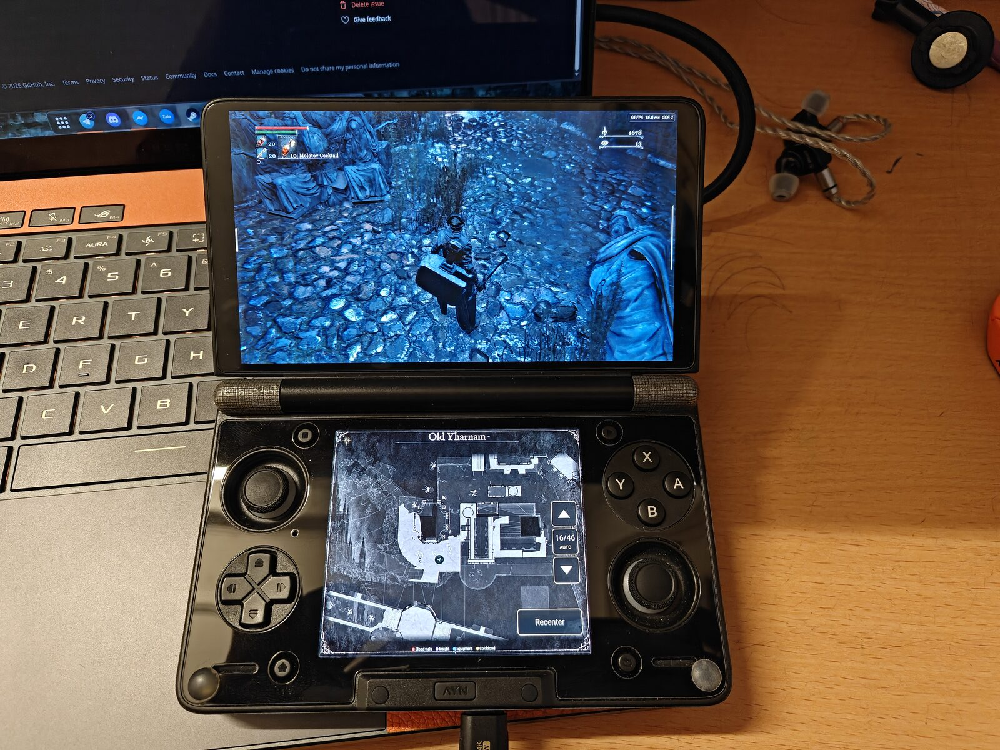
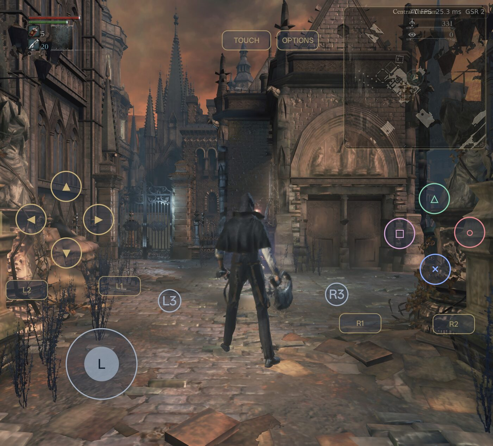
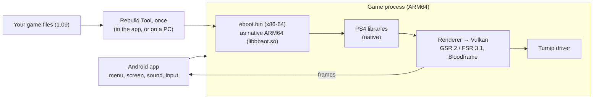

<p align="center"><a href="https://paypal.me/Ducvd89"></a></p>

<h1 align="center">Bloodborne-Android</h1>

<p align="center">
  <b>Bloodborne on Android</b>, for Snapdragon (Adreno) phones and handhelds.<br><b>Mali GPUs are not supported:</b> the Mali driver is in the app for testing only and does not run the game yet.
</p>

<p align="center">
  <a href="https://github.com/ducvd89/Bloodborne-Android/releases/latest"></a>
  
  
  
  <a href="LICENSE"></a>
</p>

<table align="center">
  <tr>
    <td align="center" width="50%"><br><sub>AYN Thor · Snapdragon 8 Gen 2 · Hunter's Atlas map on the second screen</sub></td>
    <td align="center" width="50%"><br><sub>Oppo Find N5 · Snapdragon 8 Elite · on-screen controller and floating mini map</sub></td>
  </tr>
</table>

A port of Bloodborne (PS4, **v1.09**), not an emulator. Experimental. You need your own copy of the game.

> **New in 2.1.0 (Beta 1): the app builds the game's native code on the phone.** Since 2.0.0 the game runs as native ARM64 code made from **your own game files**. Until now that needed a PC. Now the app does it itself: when the native code is missing, the app asks, and a few minutes later the game starts. Building on a PC with the free [Bloodborne Android Rebuild Tool](https://github.com/ducvd89/Bloodborne-android-rebuild-tool) still works.

## How to get the game running

1. **Install the APK** from [Releases](https://github.com/ducvd89/Bloodborne-Android/releases/latest).
2. **Put the game on the phone.** Either **Install from PKG** (the base game PKG and the 1.09 update PKG; it is offered when you choose the game folder), or choose a folder that already holds an extracted 1.09 game (`eboot.bin`, `sce_module/`, `sce_sys/` and the rest) with Menu → **Game folder**. Use the original 1.09 `eboot.bin`: pre-patched 60 FPS ones crash in the gestures menu. Tested with **CUSA03173**; other 1.09 releases should work but are untested.
3. **Start the game.** The first time, the app says **Native code needed** and offers three choices: **Build on this phone**, **Build on a PC** and **Quit**. Choose the first one and follow the steps below. When it is done, **Start game**.

## Native code (required)

The game's x86-64 code is translated to ARM64 ahead of time, once, into a file `libbbaot.so` (with `libbbaot.json`, which says which game build and which tool it came from). The app has no x86 emulator, so **the game does not start without it**. The translation is made from the game's own program, so it belongs to the game's copyright holders: **it cannot be downloaded from here or anywhere else, and you have to build it from your own game.** Nothing is uploaded; everything runs on your device or your PC. **Never share the files it writes.**

### On the phone (default)

Menu → **Native CPU** → **Rebuild on this phone**, or the **Build on this phone** choice of the **Native code needed** dialog. The app runs the same compiler as the PC tool (Rebuild Tool 1.2.1, built into the app; it writes the same code as the PC tool 1.2.0) on the game image it already made, and writes the same `libbbaot.so` a PC would.

| | |
|---|---|
| **Time** | About **6 minutes** on a Snapdragon 8 Gen 2 (AYN Thor) with the charger connected. Other phones differ; the dialog shows its estimate for your phone. |
| **Heat** | The fast cores run at full speed for the whole build. The CPU reaches about **95 °C**: take the phone out of its case and do not hold it on your lap. |
| **Charger** | Connect it. The app asks you to confirm if you build on the battery, which is slower and uses a lot of it. |
| **Memory** | About **4 GB of free RAM** (the app picks 1 to 4 parallel jobs to fit your free memory; the game is closed first). With less than about 1.5 GB free it cannot build here. |
| **Storage** | About **1 GB free** in the app's storage while it works, about 130 MB for the result. |
| **Phone** | arm64 only. |

What you see: two confirmations (the phone will get hot; the charger), then a progress bar with the stage, the time left, the time elapsed, the CPU temperature (when the phone lets the app read it), the charger and the memory used. **Run in background** closes the dialog and the build goes on with a notification; you can use other apps, but do not close Bloodborne from the recent apps. **Cancel** stops it and keeps the finished parts. If a build stops for any reason (cancel, a crash, the phone restarted), the next start offers **Continue the build** and goes on where it left off. If it fails, the dialog shows the reason with **Retry** and **Report a problem**.

When it is done the app checks the result (game build, ABI version, checksum), installs it, and also keeps a copy in the game folder's `aot/` so the folder always holds the current library.

### On a PC

The Rebuild Tool 1.2.0 for Windows and Linux makes the same files from the PKG files or from an extracted game. It is the way to go if the phone is too slow, too hot, or short of memory. The **Build on a PC** choice of the dialog opens the tool's page in your browser; the tool's own [README](https://github.com/ducvd89/Bloodborne-android-rebuild-tool#readme) has the full guide with every message.

1. Download **Rebuild Tool 1.2.0** from the [Rebuild Tool releases](https://github.com/ducvd89/Bloodborne-android-rebuild-tool/releases/latest). Windows (10 1903 or newer, or 11): `bb-recomp-windows-x86_64.zip`, unzip it and run `bb-recomp.exe` (if SmartScreen warns, **More info**, then **Run anyway**: the tool is not signed). Linux (glibc 2.35 or newer): `Bloodborne-Android-Rebuild-Tool-x86_64.AppImage`, `chmod +x` it and run it. It needs a processor with AVX2 and 8 GB of free RAM, and about 3 GB of disk (plus the PKG size when you start from PKGs). It is free: if you paid for it, you were scammed.
2. Choose your source: **From PKG files** (the folder with the base game PKG and the 1.09 update PKG; the tool writes the whole game folder with `aot/` inside), or **From an extracted game** (the folder with `eboot.bin`; the tool writes only `aot/`). Choose an empty output folder and press **Build**. It takes a few minutes (a PKG source adds a damage check and unpacking).
3. Copy the result to the phone with a cable, a card reader or `adb push`: the whole game folder, or only the `aot` folder next to `eboot.bin`.
4. In the app: Menu → **Game folder** → choose the folder with `eboot.bin` and `aot`. Or, with the **Native code needed** dialog open, copy the `aot` folder in and press **Check again**. The app checks it (game build, ABI version, checksum) and imports it by itself. **Native CPU** in the menu can also import `libbbaot.so` and `libbbaot.json` by hand.

The same program runs without a window: `bb-recomp --pkgs <PKG folder> --out <folder>` or `bb-recomp --game <game folder or its eboot.bin> --out <folder>`.

### When you have to build it again

- **After an app update that changes the ABI version.** 2.1.0 does (ABI 2): every library built by Rebuild Tool 1.1.0 or older is refused, and the app asks for a rebuild once. This also brings the Rebuild Tool 1.2.0 fix for the game stopping with `guest trap (0x800d0b, 0x287188a)`.
- **After a fix in the tool** that the app tells you about the same way (a new ABI version).
- **When the game changes:** another game build in the folder (the library has to be built from the **same game build**, the original 1.09 `eboot.bin`).
- **When the library is damaged** (the checksum does not match) or its two files do not belong together.
- If the game stops with *"native code is missing an entry"*, send `logs/aot-misses.log` (Menu → **Report a problem**): the tool can close the gap from that log (`--extra-entries`), and you rebuild once on a PC.

A new phone does not need a new build when the ABI version is the same: copy the `aot` folder to it.

### If something goes wrong

- **The phone build stops with a message:** the dialog shows it. Out of memory (the phone's memory manager killed it): close other apps and **Retry**; the finished parts are kept. Too hot: let it cool, **Retry** later. Anything else: **Report a problem**; the report includes the build's log.
- **A PKG is reported damaged or incomplete** (PC tool): that file was not copied or downloaded completely. Get that one file again and rebuild; nothing was unpacked.
- **"This does not look like a Bloodborne game folder"** (PC tool, source B): choose the folder that directly holds `eboot.bin`, `sce_module` and `sce_sys`.
- **"This game is not supported":** the game is not 1.09, the update is not merged in, or the `eboot.bin` is a patched one. Use the original 1.09 files.
- **The app says the library is "not for this game" or has "another ABI version":** build again (on the phone, or on a PC with Rebuild Tool 1.2.0) from the game files you play.
- **The game stops with "the game stopped itself after an internal error (panic)":** no native code is missing: the game's own error check fired (the message after it is the game's text). Report it with the log.
- **Out of memory, or the PC freezes while building on a PC:** close other programs, or use the command line with `--jobs 4 --mem-fraction 0.4`.

## Features

- **Native ARM64 game code** (2.0.0), **built on the phone** (new in 2.1.0): no x86 emulator, no translation while you play (see the guide above).
- **Snapdragon GSR 2 upscaling** (default since 0.11.0): Qualcomm's upscaler made for Adreno, about 1.1 ms per frame on the Thor. FSR 3.1 is also available.
- **Bloodframe frame generation**: Lossless Scaling frame generation (2x to 4x) with FP16 and low input lag. Needs your own `Lossless.dll`. It pauses by itself while a movie plays.
- **Any screen shape and resolution**: aspect ratio Auto, 4:3 to 32:9, and output from 360p up to your screen's own size.
- **Real game speed** down to 20 FPS, instead of slow motion below 30.
- **GPU driver included**: Turnip for Adreno 6xx/7xx and 8xx, picked for you.
- **Controls**: on-screen controller, physical controllers, **button remapping** and **controller vibration** (new in 2.0.0).
- **Game language** (new in 2.0.0): pick the game's own language in Game settings.
- **Mods** (.zip, .7z, .pkg) and **cheats** (infinite health and items).
- **Online play** (1.2.0): co-op, PvP, notes and bloodstains through the community servers **Seamless Hunt** (account from seamlesshunt.com) or **The Hunter's Dream** (Discord sign-in). Online status badge on the game screen; cheats and pause are off while you play online. Seamless co-op is available as an experimental option.
- **Hunter's Atlas live map** (1.1.0): your position, floors, lamps, pickups and NPCs on a second screen (the AYN Thor's other screen, or an external display), or as a floating mini map over the game. Based on [Hunter's Atlas](https://github.com/MikeTat1988/HuntersAtlas) by MikeTat1988; the map data (about 34 MB) is downloaded when you turn it on and updates itself.
- **Route finding on the map** (1.2.0): tap a lamp, item, NPC or any spot to get a route drawn as footprints, with ladders, lifts, drops, levers and doors (open, closed, which side opens). Hold the mini map for 2 seconds to open the full map over the game.
- **Pause game** from the side menu; the game also pauses on its own when you leave the app or the screen turns off.
- **Unified memory** (1.0.0): vertex and index data is shared by the game and the GPU instead of kept twice, about 8% less RAM.
- **Updates and bug reports from the app's menu.**

## Devices

| Tested | SoC | GPU |
|---|---|---|
| AYN Thor | Snapdragon 8 Gen 2 | Adreno 740 |
| Oppo Find N5 | Snapdragon 8 Elite | Adreno 830 |

Other Adreno 6xx/7xx/8xx devices are untested. **Mali is not supported** (PanVK is included for testing only; please don't report Mali bugs). Needs Android 9+; tested with 16 GB RAM. **2.1.0 Beta 1 is a beta:** the native code and the phone build were measured on the AYN Thor (Snapdragon 8 Gen 2); other phones may build more slowly.

## Install and update

1. Install the APK from [Releases](https://github.com/ducvd89/Bloodborne-Android/releases/latest).
2. Put the game on the phone and build its native code ([how to get the game running](#how-to-get-the-game-running)).

Updating keeps your saves, settings, mods and game folder. **Updating from 2.0.x to 2.1.0 needs the native code built again once** (ABI 2): the app asks when you start the game. Update checks in the menu only offer final releases, so install a Beta by hand.

On ColorOS / OxygenOS a "Security warning" may appear at launch: tap **Got it**.

## Menu

Swipe in from the left edge or press Back.

- **Game**: Back to game, **Pause game** / Play game, Game settings (game language, skip intros and the online screen, free camera, debug menu), Cheats, Mods, **Hunter's Atlas** (map on/off, second screen or floating mini map, opacity, size, footprint size), **Online** (server, account, connection test), **Native CPU** (status of the native code, **Rebuild on this phone**, import it, link to the Rebuild Tool for PC).
- **Graphics**: aspect ratio, resolution, upscaler, FPS limit, effects; **Bloodframe**; GPU driver.
- **Controls**: on-screen controller and its layout (also moves and resizes the mini map), **Remap buttons** for gamepads, controller vibration on/off. Drag outside the buttons to turn the camera.
- **Storage**: game folder, back up and restore saves.
- **App**: Report a problem, Check for updates, Debug options (turn off unified memory if you see new glitches or crashes).

## About the native code

- **Without a matching `libbbaot.so` the game does not start.** The app checks at every start: the installed library is used when it fits the game (game build, ABI version 2, checksum); else the `aot/` folder in the game folder is imported when it fits; else the **Native code needed** dialog opens (once per game folder; close it and a full-screen message with a **Rebuild native code** button stays). Menu → **Native CPU** shows what is installed and whether it fits.
- **Installing PKGs on the phone** (**Install from PKG**) extracts the game; the native code comes next, from the dialog.
- Details of the tool's phone build and its file formats: the [Rebuild Tool's documentation](https://github.com/ducvd89/Bloodborne-android-rebuild-tool/blob/main/docs/NATIVE_CPU.md).

## Settings and performance

The defaults are tuned on the AYN Thor: **GSR 2 Performance** at 1080p output (a 960×540 scene), costly effects off, lowest model detail, 60 FPS limit. Updating from 0.10.x or older switches the upscaler to GSR 2 once; you can change it back in Graphics settings.

- **Upscaler presets** set the scene size relative to the output: Quality 67%, Balanced 59%, Performance 50%, Ultra Performance 33%.
- **Model detail** matters more than resolution on the Thor: the GPU spends most of its time on geometry.
- **Above 1080p** uses much more memory: stay at 1080p or below with less than 12 GB of RAM.
- **Keep game speed when FPS drops** (on): the game keeps its speed down to 20 FPS. Turn it off if physics misbehave.

## Bloodframe

Bloodframe is this port's frame generation engine ([ducvd89/bloodframe](https://github.com/ducvd89/bloodframe), based on lsfg-vk 1.0, MIT). It runs Lossless Scaling's LSFG 3.1 with the shaders from your own `Lossless.dll`; the Bloodframe page can download it through Steam sign-in.

Recommended: **2×, performance mode on, FP16 on** (the defaults). Works best at 30 FPS or more. It works with any upscaler, and changes apply while you play. Details: [docs/ANDROID_LSFG.md](docs/ANDROID_LSFG.md).

## GPU drivers

On **Automatic** the app uses its bundled driver for your GPU:

| GPU | Driver |
|---|---|
| Adreno 6xx / 7xx / 8xx | Turnip Gen8 V37 by StevenMXZ |
| Mali G610+ (Android 15+) | PanVK V3.2, **testing only** |

The phone's own Adreno driver does not run the game yet (black screen). You can also download other drivers (our Turnip 26.3.0, StevenMXZ's 26.3.0-R6 and R6 One UI) or install any adrenotools driver zip from the menu.

## Reporting problems

Menu → **Report a problem** saves a logs zip (device, settings, logs; no saves or game files) and can open a GitHub issue with it attached.

## How it works

The game's own `eboot.bin` runs on the phone as native ARM64 code: the Rebuild Tool compiled its x86-64 code ahead of time (`libbbaot.so`), once, on the phone inside the app or on a PC, and nothing is translated while you play. Its calls to PS4 system libraries go to native replacements, and its GPU commands and shaders are translated to Vulkan by shadPS4's renderer as [bloodborne_pc](https://github.com/deadinside28/bloodborne_pc) tailored it. Everything is a plain Android (NDK) program: no Linux system, Wine or Box64.



## Build

```bash
git clone --recursive https://github.com/ducvd89/Bloodborne-Android.git
cd Bloodborne-Android
bash tools/android/build_bionic_deps.sh      # once: NDK and native libraries
bash tools/android/build_bionic.sh           # the game process and tools
bash tools/android/build_release_apk.sh      # the APK
```

The APK carries the Rebuild Tool's Android package (`libbbrecomp.so` and its files, pinned by sha256 in `tools/android/fetch_recomp_android.sh`, which the build runs).

More in [docs/ANDROID_THOR.md](docs/ANDROID_THOR.md). The Linux PC build: [bbport's README](https://github.com/deadinside28/bloodborne_pc).

## Credits

[bloodborne_pc](https://github.com/deadinside28/bloodborne_pc), [shadPS4](https://github.com/shadps4-emu/shadPS4), [ARM_bloodborne_pc](https://github.com/MaSieS4Fun/ARM_bloodborne_pc), [FEX-Emu](https://github.com/FEX-Emu/FEX) (its front end builds the native code in the Rebuild Tool; the CPUID model is ported from it, MIT), [fexdroid](https://github.com/cobrabm12/fexdroid), [Mesa](https://gitlab.freedesktop.org/mesa/mesa), [mesa-unified](https://github.com/whitebelyash/mesa-unified), [StevenMXZ's Turnip builds](https://github.com/StevenMXZ/Adreno-Tools-Drivers), [panvk-kbase-android](https://github.com/JICA98/panvk-kbase-android), [Snapdragon GSR](https://github.com/SnapdragonStudios/snapdragon-gsr) (Qualcomm, BSD-3-Clause), [FSR-Vulkan](https://github.com/FireBurn/FSR-Vulkan), [lsfg-vk](https://github.com/PancakeTAS/lsfg-vk) by PancakeTAS and [GameNative's fork](https://github.com/Ragnarok93/lsfg-vk-android), [GoldHEN cheats](https://github.com/GoldHEN/GoldHEN_Cheat_Repository) (Shiningami), [Hunter's Atlas](https://github.com/MikeTat1988/HuntersAtlas) by MikeTat1988 (live map, map generator and art, GPL-2.0), [BBSC](https://github.com/CLSAMG22/BBSC) (seamless co-op), [droogie/bbhost](https://github.com/droogie/bbhost) (The Hunter's Dream backend, GPL-3.0-or-later). Online servers run by [Seamless Hunt](https://seamlesshunt.com) and [The Hunter's Dream](https://thehuntersdream.com), who are not affiliated with this app.

Licensed under [GPL-2.0-or-later](LICENSE); the online module includes GPL-3.0-or-later code (droogie/bbhost), so the app as a whole is distributed under GPL-3.0-or-later; third-party notices in [THIRD_PARTY_LICENSES.txt](tools/android/frontend/THIRD_PARTY_LICENSES.txt). Not affiliated with Sony Interactive Entertainment, FromSoftware, Qualcomm, Valve or the developers of Lossless Scaling.
