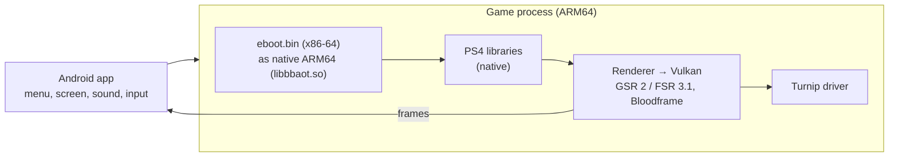

<p align="center"><a href="https://paypal.me/Ducvd89"></a></p>

<h1 align="center">Bloodborne-Android</h1>

<p align="center">
  <b>Bloodborne on Android</b>, for Snapdragon (Adreno) phones and handhelds.<br><b>Mali GPUs are not supported:</b> the Mali driver is in the app for testing only and does not run the game yet.
</p>

<p align="center">
  <a href="https://github.com/ducvd89/Bloodborne-Android/releases/latest"></a>
  
  
  
  <a href="LICENSE"></a>
</p>

<table align="center">
  <tr>
    <td align="center" width="50%"><br><sub>AYN Thor · Snapdragon 8 Gen 2 · Hunter's Atlas map on the second screen</sub></td>
    <td align="center" width="50%"><br><sub>Oppo Find N5 · Snapdragon 8 Elite · on-screen controller and floating mini map</sub></td>
  </tr>
</table>

A port of Bloodborne (PS4, **v1.09**), not an emulator. Experimental. You need your own copy of the game.

> **New in 2.0.0 (Beta 1): the game now runs as native ARM64 code.** The app has no x86 emulator any more. Instead, each player builds the game's native code **once, on a PC (Windows or Linux)**, from their own game files, with the free [Bloodborne Android Rebuild Tool](https://github.com/ducvd89/Bloodborne-android-rebuild-tool). The guide is right below. Nothing is translated while you play, so there is no translation stutter and the CPU does less work.

## How to get the game running (2.0.0)

The native code is a translation of the game's own program, so it belongs to the game's copyright holders: **it cannot be downloaded from here or anywhere else, and you must build it yourself from your own game.** The tool runs on your PC, uploads nothing, and writes one folder that holds the game and its native code. **Never share the files it writes.** The whole thing takes about 15 to 30 minutes, most of it copying files.

### What you need

- Your own Bloodborne **base game PKG** and the **1.09 update PKG**, together in one folder with nothing else in it (the same fake PKGs the app's "Install from PKG" uses). Tested with **CUSA03173**; other 1.09 releases should work but are untested.
- A PC with **Windows 10 (1903 or newer) or 11**, or **Linux with glibc 2.35 or newer** (Ubuntu 22.04, Debian 12, Fedora 36, Arch or newer), and a processor with **AVX2** (Intel from 2013, or any AMD Ryzen).
- **8 GB of free RAM** (16 GB or more is faster) and free disk space of about the size of the base game PKG plus 3 GB.
- This app (2.0.0 Beta 1 or newer) on an Adreno phone, with room for the game folder.

### Step by step

1. **Download the tool** from the [Rebuild Tool releases](https://github.com/ducvd89/Bloodborne-android-rebuild-tool/releases/latest): `bb-recomp-windows-x86_64.zip` for Windows (unzip it anywhere), or `Bloodborne-Android-Rebuild-Tool-x86_64.AppImage` for Linux (`chmod +x` it). It is free: if you paid for it, you were scammed.
2. **Start it.** On Windows, double-click `bb-recomp.exe`; if SmartScreen says the app is unknown, click **More info**, then **Run anyway** (the tool is not signed with a paid certificate). On Linux, double-click the AppImage; if nothing happens your system lacks FUSE 2, so run it from a terminal with `./Bloodborne-Android-Rebuild-Tool-x86_64.AppImage --appimage-extract-and-run`.
3. **Game PKG folder → Browse…**: choose the folder with the base game PKG and the 1.09 update PKG.
4. **Output folder → Browse…**: choose an empty folder on a disk with enough space (a short path such as `D:\bloodborne` or `~/bloodborne` is best).
5. Press **Build** and wait. The tool checks every PKG for damage first (a few minutes; a damaged file stops the build before anything is unpacked and tells you which file), unpacks and merges the game and the update, then recompiles the game's code to ARM64 (about 1 to 2 minutes on a 12-core PC, longer on a laptop).
6. When it says **Done**, the output folder holds a game folder like this:

   ```
   <output folder>/
       CUSA03173/              <- the whole game, ready for the phone
           eboot.bin, sce_sys/, sce_module/, dvdroot_ps4/ ...
           aot/
               libbbaot.so     <- the game's code as native ARM64 (about 125 MB)
               libbbaot.json   <- what it was built from (the app checks it)
   ```

7. **Copy the game folder** (`CUSA03173`, with `aot` inside) to the phone's storage or SD card: USB cable in file transfer mode, a card reader, or `adb push`. It is a large copy. **Game already installed on the phone?** Copy only the `aot` folder next to `eboot.bin` in the phone's game folder.
8. In the app, open the menu → **Game folder** and choose the folder you copied. Start the game: the app finds `aot/libbbaot.so`, checks that it matches your game (game build, ABI version, checksum) and imports it into its own storage by itself. There is nothing to switch on. The first start takes a few minutes. Menu → **Native CPU** shows the state.

**Prefer a terminal?** The same program runs without a window: `bb-recomp --pkgs <PKG folder> --out <output folder>` (on Linux pass the same arguments to the AppImage).

### If something goes wrong

- **A PKG is reported damaged or incomplete:** that file was not copied or downloaded completely. Get that one file again and rebuild; nothing was unpacked.
- **The game stops with "native code is missing an entry at +0x...":** the library does not cover a place the game jumped to. The app saved the address in `logs/aot-misses.log`. Send it with menu → **Report a problem**, copy the file to the PC and rebuild once with `bb-recomp --pkgs <PKG folder> --out <output folder> --extra-entries aot-misses.log`. Every logged address becomes an entry of the new library.
- **The app says the library is "not for this game" or has "another ABI version":** build again from the PKGs of the game you play, with the tool release that matches your app. You also need to build again after an app release that changes the ABI version.
- **Out of memory, or the PC freezes while building:** close other programs, or use the terminal with `--jobs 4 --mem-fraction 0.4`.

The tool's own [README](https://github.com/ducvd89/Bloodborne-android-rebuild-tool#readme) has the full reference with every message. A new phone does not need a new build: copy the same game folder to it.

## Features

- **Native ARM64 game code** (new in 2.0.0): no x86 emulator, no translation while you play (see the guide above).
- **Snapdragon GSR 2 upscaling** (default since 0.11.0): Qualcomm's upscaler made for Adreno, about 1.1 ms per frame on the Thor. FSR 3.1 is also available.
- **Bloodframe frame generation**: Lossless Scaling frame generation (2x to 4x) with FP16 and low input lag. Needs your own `Lossless.dll`. It pauses by itself while a movie plays.
- **Any screen shape and resolution**: aspect ratio Auto, 4:3 to 32:9, and output from 360p up to your screen's own size.
- **Real game speed** down to 20 FPS, instead of slow motion below 30.
- **GPU driver included**: Turnip for Adreno 6xx/7xx and 8xx, picked for you.
- **Controls**: on-screen controller, physical controllers, **button remapping** and **controller vibration** (new in 2.0.0).
- **Game language** (new in 2.0.0): pick the game's own language in Game settings.
- **Mods** (.zip, .7z, .pkg) and **cheats** (infinite health and items).
- **Online play** (1.2.0): co-op, PvP, notes and bloodstains through the community servers **Seamless Hunt** (account from seamlesshunt.com) or **The Hunter's Dream** (Discord sign-in). Online status badge on the game screen; cheats and pause are off while you play online. Seamless co-op is available as an experimental option.
- **Hunter's Atlas live map** (1.1.0): your position, floors, lamps, pickups and NPCs on a second screen (the AYN Thor's other screen, or an external display), or as a floating mini map over the game. Based on [Hunter's Atlas](https://github.com/MikeTat1988/HuntersAtlas) by MikeTat1988; the map data (about 34 MB) is downloaded when you turn it on and updates itself.
- **Route finding on the map** (1.2.0): tap a lamp, item, NPC or any spot to get a route drawn as footprints, with ladders, lifts, drops, levers and doors (open, closed, which side opens). Hold the mini map for 2 seconds to open the full map over the game.
- **Pause game** from the side menu; the game also pauses on its own when you leave the app or the screen turns off.
- **Unified memory** (1.0.0): vertex and index data is shared by the game and the GPU instead of kept twice, about 8% less RAM.
- **Updates and bug reports from the app's menu.**

## Devices

| Tested | SoC | GPU |
|---|---|---|
| AYN Thor | Snapdragon 8 Gen 2 | Adreno 740 |
| Oppo Find N5 | Snapdragon 8 Elite | Adreno 830 |

Other Adreno 6xx/7xx/8xx devices are untested. **Mali is not supported** (PanVK is included for testing only; please don't report Mali bugs). Needs Android 9+; tested with 16 GB RAM. **2.0.0 Beta 1 is a beta:** the native code was tested on the AYN Thor (Snapdragon 8 Gen 2).

## Install and update

1. Install the APK from [Releases](https://github.com/ducvd89/Bloodborne-Android/releases/latest).
2. Build the game once on a PC with the Rebuild Tool and copy the folder to the phone ([guide above](#how-to-get-the-game-running-200)), then pick it in the app.

Already have an extracted 1.09 dump? Point the tool at it (`--game <dump>`) instead of PKGs, or install PKGs on the phone from the app (**Install from PKG**) and add the native code afterwards (see below). The app does not start the game without the native code.

Use the original 1.09 `eboot.bin`: pre-patched 60 FPS ones crash in the gestures menu. Updating keeps your saves, settings, mods and game folder; after updating from 1.2.0 or earlier you still need the native code before the game starts. Update checks in the menu only offer final releases, so install a Beta by hand.

On ColorOS / OxygenOS a "Security warning" may appear at launch: tap **Got it**.

## Menu

Swipe in from the left edge or press Back.

- **Game**: Back to game, **Pause game** / Play game, Game settings (game language, skip intros and the online screen, free camera, debug menu), Cheats, Mods, **Hunter's Atlas** (map on/off, second screen or floating mini map, opacity, size, footprint size), **Online** (server, account, connection test), **Native CPU** (status of the native code, import it, link to the Rebuild Tool).
- **Graphics**: aspect ratio, resolution, upscaler, FPS limit, effects; **Bloodframe**; GPU driver.
- **Controls**: on-screen controller and its layout (also moves and resizes the mini map), **Remap buttons** for gamepads, controller vibration on/off. Drag outside the buttons to turn the camera.
- **Storage**: game folder, back up and restore saves.
- **App**: Report a problem, Check for updates, Debug options (turn off unified memory if you see new glitches or crashes).

## Native code (required)

Since 2.0.0 the app has no x86 translator: the game's code runs only as ahead-of-time compiled ARM64 code, in the file `libbbaot.so` (with `libbbaot.json`, which says which game build it was made from). It is made from **your** game, so it cannot be downloaded or shared: you build it once, on a PC, with the [Rebuild Tool](https://github.com/ducvd89/Bloodborne-android-rebuild-tool) as described in the [guide at the top](#how-to-get-the-game-running-200). A phone-only install cannot produce it.

- **Without a matching `libbbaot.so` the game does not start.** The app shows a full-screen message with the steps, a button to the tool's page, and **Choose game folder** / **Import libbbaot.so…**. The same page is in the menu under **Native CPU**, which shows what is installed and whether it fits your game.
- **Choosing the folder the tool made** imports `aot/libbbaot.so` and `aot/libbbaot.json` automatically (the app copies them into its own storage). You can also import the two files by hand.
- The library has to be built from the **same game build** (the original 1.09 `eboot.bin`) and by a tool version that matches the app (ABI version 1). The app checks both and the file's checksum before the game starts.
- **Installing PKGs on the phone** (**Install from PKG**) still extracts the game, but it cannot make the native code: the tool's output already contains the game and the native code together, so building the folder on the PC is the recommended path.
- If the game stops with *"native code is missing an entry"*, send the `logs/aot-misses.log` (Menu → **Report a problem**): the tool can close the gap from that log and you rebuild once.
- If it stops with *"the game stopped itself after an internal error (panic)"*, no native code is missing: the game's own error check fired (the message after it is the game's text); report it with the log instead.

## Settings and performance

The defaults are tuned on the AYN Thor: **GSR 2 Performance** at 1080p output (a 960×540 scene), costly effects off, lowest model detail, 60 FPS limit. Updating from 0.10.x or older switches the upscaler to GSR 2 once; you can change it back in Graphics settings.

- **Upscaler presets** set the scene size relative to the output: Quality 67%, Balanced 59%, Performance 50%, Ultra Performance 33%.
- **Model detail** matters more than resolution on the Thor: the GPU spends most of its time on geometry.
- **Above 1080p** uses much more memory: stay at 1080p or below with less than 12 GB of RAM.
- **Keep game speed when FPS drops** (on): the game keeps its speed down to 20 FPS. Turn it off if physics misbehave.

## Bloodframe

Bloodframe is this port's frame generation engine ([ducvd89/bloodframe](https://github.com/ducvd89/bloodframe), based on lsfg-vk 1.0, MIT). It runs Lossless Scaling's LSFG 3.1 with the shaders from your own `Lossless.dll`; the Bloodframe page can download it through Steam sign-in.

Recommended: **2×, performance mode on, FP16 on** (the defaults). Works best at 30 FPS or more. It works with any upscaler, and changes apply while you play. Details: [docs/ANDROID_LSFG.md](docs/ANDROID_LSFG.md).

## GPU drivers

On **Automatic** the app uses its bundled driver for your GPU:

| GPU | Driver |
|---|---|
| Adreno 6xx / 7xx / 8xx | Turnip Gen8 V37 by StevenMXZ |
| Mali G610+ (Android 15+) | PanVK V3.2, **testing only** |

The phone's own Adreno driver does not run the game yet (black screen). You can also download other drivers (our Turnip 26.3.0, StevenMXZ's 26.3.0-R6 and R6 One UI) or install any adrenotools driver zip from the menu.

## Reporting problems

Menu → **Report a problem** saves a logs zip (device, settings, logs; no saves or game files) and can open a GitHub issue with it attached.

## How it works

The game's own `eboot.bin` runs on the phone as native ARM64 code: the Rebuild Tool compiled its x86-64 code ahead of time (`libbbaot.so`), and nothing is translated while you play. Its calls to PS4 system libraries go to native replacements, and its GPU commands and shaders are translated to Vulkan by shadPS4's renderer as [bloodborne_pc](https://github.com/deadinside28/bloodborne_pc) tailored it. Everything is a plain Android (NDK) program: no Linux system, Wine or Box64.



## Build

```bash
git clone --recursive https://github.com/ducvd89/Bloodborne-Android.git
cd Bloodborne-Android
bash tools/android/build_bionic_deps.sh      # once: NDK and native libraries
bash tools/android/build_bionic.sh           # the game process and tools
bash tools/android/build_release_apk.sh      # the APK
```

More in [docs/ANDROID_THOR.md](docs/ANDROID_THOR.md). The Linux PC build: [bbport's README](https://github.com/deadinside28/bloodborne_pc).

## Credits

[bloodborne_pc](https://github.com/deadinside28/bloodborne_pc), [shadPS4](https://github.com/shadps4-emu/shadPS4), [ARM_bloodborne_pc](https://github.com/MaSieS4Fun/ARM_bloodborne_pc), [FEX-Emu](https://github.com/FEX-Emu/FEX) (its front end builds the native code in the Rebuild Tool; the CPUID model is ported from it, MIT), [fexdroid](https://github.com/cobrabm12/fexdroid), [Mesa](https://gitlab.freedesktop.org/mesa/mesa), [mesa-unified](https://github.com/whitebelyash/mesa-unified), [StevenMXZ's Turnip builds](https://github.com/StevenMXZ/Adreno-Tools-Drivers), [panvk-kbase-android](https://github.com/JICA98/panvk-kbase-android), [Snapdragon GSR](https://github.com/SnapdragonStudios/snapdragon-gsr) (Qualcomm, BSD-3-Clause), [FSR-Vulkan](https://github.com/FireBurn/FSR-Vulkan), [lsfg-vk](https://github.com/PancakeTAS/lsfg-vk) by PancakeTAS and [GameNative's fork](https://github.com/Ragnarok93/lsfg-vk-android), [GoldHEN cheats](https://github.com/GoldHEN/GoldHEN_Cheat_Repository) (Shiningami), [Hunter's Atlas](https://github.com/MikeTat1988/HuntersAtlas) by MikeTat1988 (live map, map generator and art, GPL-2.0), [BBSC](https://github.com/CLSAMG22/BBSC) (seamless co-op), [droogie/bbhost](https://github.com/droogie/bbhost) (The Hunter's Dream backend, GPL-3.0-or-later). Online servers run by [Seamless Hunt](https://seamlesshunt.com) and [The Hunter's Dream](https://thehuntersdream.com), who are not affiliated with this app.

Licensed under [GPL-2.0-or-later](LICENSE); the online module includes GPL-3.0-or-later code (droogie/bbhost), so the app as a whole is distributed under GPL-3.0-or-later; third-party notices in [THIRD_PARTY_LICENSES.txt](tools/android/frontend/THIRD_PARTY_LICENSES.txt). Not affiliated with Sony Interactive Entertainment, FromSoftware, Qualcomm, Valve or the developers of Lossless Scaling.
